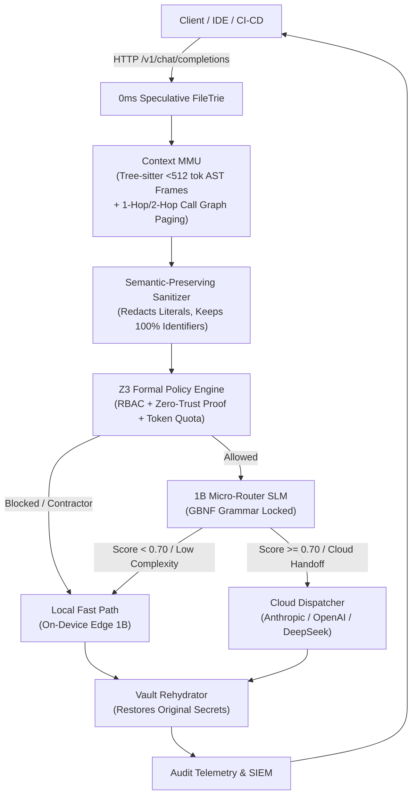

# Phonix v2.0

> **Zero-Trust AST Paging & 1B Micro-Router Gateway**  
> *Enterprise Compliance & Cost Gateway + Context MMU*

[](LICENSE)
[](pyproject.toml)
[](ARCHITECTURE.md)

---

## 1. Executive Summary

**Phonix v2.0** is an enterprise-grade AI infrastructure gateway engineered to solve two fundamental scaling barriers in modern generative code systems:
1. **Uncontrolled Cloud Spend & Context Bloat**: Naive retrieval injects massive codebases into frontier models, causing astronomical token bills and high latency.
2. **Zero-Trust Compliance & Data Leakage**: Enterprise proprietary secrets, internal IP addresses, customer PII, and sensitive intellectual property risk leaking into external LLM training loops or unauthorized regions.

Phonix v2.0 decouples context retrieval and security enforcement from frontier models by introducing an on-device **Context MMU (Memory Management Unit)** paired with a **1.2GB local 1B Micro-Router SLM** locked by formal GBNF grammars.

---

## 2. Core Architectural Pillars



### A. Context MMU (`src/mmu/`)
- **0ms Speculative I/O (`FileTrie`)**: Indexes repository files in-memory; proactively scans streaming JSON chunks over HTTP to stage AST frames before the request payload completes.
- **Deterministic Tree-sitter AST Slicing (`ASTSlicer`)**: Guarantees all semantic code frames (functions, methods, classes) are strictly `< 512 tokens`.
- **Static Call-Graph Expansion (`CallGraphPager`)**: Deterministically pages 1-hop and 2-hop caller/callee dependencies without loading entire codebases. **Explicitly NO Z3 for code transpilation.**
- **Pinned KV Prefix Cache (`KVPrefixCache`)**: Manages pinned prompt tokens for enterprise system instructions to maximize prefix cache hits on llama.cpp / vLLM.
- **Deterministic Eviction (`FrameEvictor`)**: LRU & priority-weighted context budget eviction.

### B. 1B Micro-Router (`src/micro_router/`)
- **Resource Footprint**: Constrained to a strict **1.2GB VRAM envelope** using Q4_K_M quantization (Llama-3.2-1B-Instruct or Qwen2.5-Coder-1.5B).
- **Strict GBNF Grammar Locking (`router_decision.gbnf`)**: Constrains SLM decoding to perform **ONLY two tasks**:
  1. **AST Context Pruning**: Selects relevant frames and prunes irrelevant context.
  2. **Complexity Scoring for Circuit Breaking**: Outputs normalized score `[0.0 - 1.0]` and `trigger_cloud_handoff` flag.

### C. Enterprise Compliance Gateway (`src/gateway/`)
- **OpenAI/Anthropic Compatible Proxy (`/v1/chat/completions`)**: Drop-in proxy for Cursor, VS Code, continue.dev, and corporate agent frameworks.
- **Semantic-Preserving AST Sanitizer (`SemanticSanitizer`)**: Redacts ONLY sensitive literals (API keys, secrets, private IPs, PII) into typed placeholders (`<REDACTED_SECRET_01>`, `<REDACTED_IP_01>`) while keeping **100% of variable and function identifiers intact**.
- **Z3 Formal Policy Engine (`PolicyEngine`)**: Employs the Z3 SMT solver strictly for mathematical proofs of RBAC, zero-trust cloud egress safety, and department token quotas.
- **Ephemeral Rehydration (`Rehydrator`)**: Transparently restores authentic secrets in completion outputs before delivering to the client application.

### D. Moat Flywheel (`moat_flywheel/`)
- **Git Diff Harvester (`GitDiffHarvester`)**: Scans developer commits, PR diffs, and AST modifications.
- **Dataset Builder (`DatasetBuilder`)**: Converts real-world developer interactions into GBNF-aligned instruction-tuning pairs.
- **Router LoRA Trainer (`RouterLoRATrainer`)**: Fine-tunes and quantizes on-device routing LoRA weights.

---

## 3. Project Directory Tree

```text
Phonix/
├── README.md                              # Comprehensive guide & project overview
├── ARCHITECTURE.md                        # Deep technical architecture specification
├── pyproject.toml                         # Project metadata, dependencies & scripts
├── config/
│   ├── zero_trust_policy.yaml             # Secret regex rules, PII types, quotas, RBAC
│   ├── hardware_profile.yaml              # VRAM 1.2GB cap, Q4_K_M, pinned KV cache budget
│   └── cloud_upstreams.yaml               # Anthropic, OpenAI, DeepSeek configs & fallbacks
├── src/
│   ├── __init__.py                        # Core package initialization
│   ├── main.py                            # CLI entrypoint & server bootstrap
│   ├── gateway/
│   │   ├── __init__.py                    # Gateway module exports
│   │   ├── proxy_server.py                # FastAPI proxy server (/health, /v1/chat/completions)
│   │   ├── semantic_sanitizer.py          # Semantic-preserving literal sanitizer & vault
│   │   ├── policy_engine.py               # Z3 SMT formal zero-trust policy engine
│   │   ├── rehydrator.py                  # Response placeholder rehydrator
│   │   └── audit_telemetry.py             # Compliance audit logger & FinOps metrics
│   ├── mmu/
│   │   ├── __init__.py                    # MMU module exports
│   │   ├── file_trie.py                   # In-memory File Trie for 0ms speculative I/O
│   │   ├── speculative_inspector.py       # Streaming HTTP chunk inspector
│   │   ├── ast_slicer.py                  # Tree-sitter AST slicer (<512 tokens/frame)
│   │   ├── call_graph_pager.py            # Static 1-hop/2-hop call graph pager (BFS)
│   │   ├── kv_prefix_cache.py             # Pinned KV cache prefix manager
│   │   └── frame_evictor.py               # Deterministic LRU/Priority frame evictor
│   ├── micro_router/
│   │   ├── __init__.py                    # Micro-Router module exports
│   │   ├── slm_engine.py                  # 1B local SLM runner (1.2GB VRAM envelope)
│   │   ├── gbnf_enforcer.py               # GBNF grammar parser & schema validator
│   │   ├── circuit_breaker.py             # Cloud handoff & upstream fallback controller
│   │   └── grammars/
│   │       └── router_decision.gbnf       # Strict GBNF grammar for routing decisions
│   └── execution/
│       ├── __init__.py                    # Execution module exports
│       ├── local_fast_path.py             # Zero-cloud on-device completion engine
│       └── cloud_dispatcher.py            # Resilient cloud dispatcher with fallbacks
├── moat_flywheel/
│   ├── __init__.py                        # Flywheel module exports
│   ├── git_diff_harvester.py              # Git commit & AST symbol harvester
│   ├── dataset_builder.py                 # GBNF instruction dataset synthesizer
│   └── train_router_lora.py               # Router LoRA fine-tuning & GGUF exporter
├── integrations/
│   ├── ci_cd_gate/
│   │   └── README.md                      # GitHub Actions & CI/CD compliance gate guide
│   └── admin_dashboard/
│       └── README.md                      # FinOps & enterprise observability dashboard guide
└── tests/
    ├── __init__.py                        # Test suite initialization
    ├── test_speculative_trie.py           # Unit tests for FileTrie & 0ms speculative I/O
    ├── test_call_graph_pager.py           # Unit tests for CallGraphPager & token limits
    ├── test_semantic_sanitizer.py         # Unit tests for literal sanitization & vault
    └── test_policy_engine.py              # Unit tests for Z3 formal policy verification
```

---

## 4. Quickstart Guide

### Installation
```bash
# Clone the repository
git clone https://github.com/your-org/phonix.git
cd Phonix

# Install in development mode
pip install -e .

# With optional local SLM and dev tools
pip install -e ".[local-router,dev]"
```

### CLI Commands
```bash
# Display hardware profile and engine status
phonix status

# Run Z3 formal policy verification on sample parameters
phonix verify-policy --role engineer --dept engineering --unredacted-secrets 0

# Test contractor isolation policy
phonix verify-policy --role contractor --dept engineering

# Launch the FastAPI gateway server
phonix start --host 0.0.0.0 --port 8000
```

### Testing OpenAI SDK Compatibility
```python
from openai import OpenAI

client = OpenAI(
    base_url="http://localhost:8000/v1",
    api_key="phonix-enterprise-key",
)

response = client.chat.completions.create(
    model="phonix-v2",
    messages=[
        {"role": "system", "content": "You are a senior systems engineer."},
        {"role": "user", "content": "Inspect src/gateway/proxy_server.py and refactor handle_request."},
    ],
    extra_body={
        "user_role": "engineer",
        "department": "engineering",
    }
)

print(response.choices[0].message.content)
```

---

## 5. Verification & Testing

Execute the complete test suite:
```bash
# Run tests with pytest
pytest tests/ -v

# Or run tests directly
python tests/test_speculative_trie.py
python tests/test_call_graph_pager.py
python tests/test_semantic_sanitizer.py
python tests/test_policy_engine.py

# Verify syntax across all modules
python -m compileall src tests moat_flywheel
```
