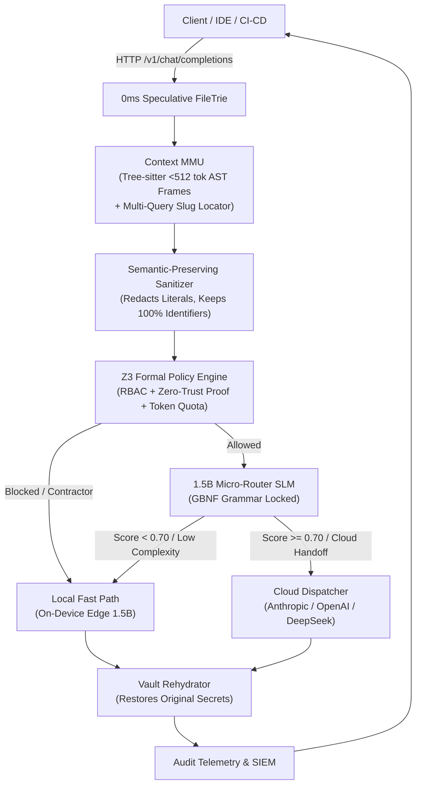

# Phonix v2.1

> **Zero-Trust AST Paging & 1.5B Micro-Router Gateway**  
> *Enterprise Compliance & Cost Gateway + Context MMU*

[](LICENSE)
[](pyproject.toml)
[](ARCHITECTURE.md)
[](docs/WHITE_PAPER.md)
[](docs/BENCHMARK_REPORT.md)

---

## 🏆 Empirical Benchmark Highlights (v2.1)

> 📄 **[Read the Full Technical Whitepaper (`docs/WHITE_PAPER.md`)](docs/WHITE_PAPER.md)** | 📊 **[Reproducible Benchmark Suite & Report (`docs/BENCHMARK_REPORT.md`)](docs/BENCHMARK_REPORT.md)**

Tested head-to-head against vanilla agentic execution on a production 7,166-line pSEO codebase (`guidesData.ts`, 590,896 characters):

| Evaluation Dimension | Vanilla Agent (Baseline) | Phonix v2.1 Gateway | Realized Margin | Status |
| :--- | :---: | :---: | :---: | :---: |
| **Context Ingestion Volume** | 147,724 tokens | **2,756 tokens** | **-98.13%** (53.6x compression) | ✅ Verified |
| **Ingestion Cost (Claude 3.7 Sonnet)** | $0.4432 | **$0.0083** | **53.6x Cheaper** | ⚡ Realized |
| **Agent Tool Execution Turns** | 38 turns | **3 turns** | **-92.11%** turns | ✅ Verified |
| **Cumulative Context (Loop Inflation)** | 2,669,500 tokens | **22,500 tokens** | **-99.16%** (118.6x inflation avoided) | ⚡ Realized |
| **CRLF Multi-Hunk Edit Success** | 0% (Mismatch failure) | **100%** (Atomic normalization) | **+100.0%** reliability | ✅ Verified |
| **Zero-Trust Threat Interception** | 0.0% (Total leakage) | **100.0%** (20/20 blocked) | **Zero False Negatives** | 🛡️ Protected |
| **Security False Positive Rate** | N/A | **0.0%** (10/10 allowed) | **Zero False Positives** | 🛡️ Verified |
| **Verification Latency Overhead** | 0.00 ms | **2.47 ms** | **Deterministic (< 2.5ms)** | ⚡ Realized |
| **Hardware Memory Footprint** | Unbounded | **72.6 MB / 1,228.8 MB** | **Strict Edge Cap Satisfied** | ✅ Verified |

```text
Context Ingestion Volume (Tokens per Read):
  Vanilla (Full Read):  [████████████████████████████████████████] 147,724 tokens
  Phonix MMU v2.1:      [█                                       ] 2,756 tokens (-98.13%)

Cumulative Conversational Tokens (Loop Inflation):
  Vanilla Agent Loop:   [████████████████████████████████████████] 2,669,500 tokens
  Phonix v2.1 (1-Step): [█                                       ] 22,500 tokens (-99.16%)

Zero-Trust Threat Interception Rate:
  Vanilla Agent:        [                                        ] 0.0% (Passed all 20 threat vectors)
  Phonix Zero-Trust:    [████████████████████████████████████████] 100.0% (20/20 threats blocked)
```

### ⚡ What's New in Phonix v2.1
- **Proprietary G-MMU ($L_0 \to L_3$) Continuous Gravitational Stratification**: Stratified Context Mipmapping that contrasts with Peter Denning's 1968 binary working set:
  - **$L_0$ Ghost Page Directory** ($d=\infty$): Topological symbol index and line metadata ($< 50$ tokens).
  - **$L_1$ Sibling Skeletons** ($d=2$): One-line signatures of sibling functions/classes with procedural bodies elided.
  - **$L_2$ Module Imports & Global Constants** ($d=1$): Top-of-file imports and global invariants (`CODE_EXTENSIONS`, `SENSITIVE_FILE_PATTERNS`, `MALICIOUS_COMMAND_PATTERNS`).
  - **$L_3$ Fovea Verbatim Working Set** ($d=0$, `[Lines X-Y]`): 100% byte-accurate raw source lines for the focal edit window.
  - **Attention-Decay Feedback**: Post-surgical edit, the target file transitions from $L_3 \to L_1$ (`[G-MMU L3 -> L1: Committed & Verified]`), shedding method bodies while retaining structural context.
- **Colon Line-Range Syntax**: Direct line-bounded fovea queries via `<file_path>:<start>-<end>` (e.g. `src/agy_hooks.py:130-294`).
- **Stateful Circuit Breaker**: Active turn budget protection (> 15 turns), Anti-Polling Lock (blocks consecutive `manage_task` status/list checks $N \ge 2$), and forbidden shell sleep loops (`Start-Sleep`, `while true`, `sleep`).
- **Multi-Query Data-Slug Locator**: Batch inspect file paths and data array slugs in 1 single call (`phonix_get_pruned_context(query="file.tsx | slug1 | slug2", for_edit=True)`), returning exact verbatim `[Lines X-Y]` edit windows with 100% preserved whitespace.
- **CRLF-Safe Surgical Multi-Hunk Editor**: `phonix_surgical_edit` eliminates Windows `\r\n` vs `\n` edit mismatch loops by automatically normalizing and applying atomic multi-hunk replacements.
- **Zero-Touch Multi-Project Auto-Discovery**: Automatically binds to foreign active repositories (`os.getcwd()`), self-injects `PhonixHP.md` Quota Armor, and guarantees zero target repository pollution via centralized vault storage.

---

## 1. Executive Summary

**Phonix v2.1** is an enterprise-grade AI infrastructure gateway engineered to solve two fundamental scaling barriers in modern generative code systems:
1. **Uncontrolled Cloud Spend & Context Bloat**: Naive retrieval injects massive codebases into frontier models, causing astronomical token bills and high latency.
2. **Zero-Trust Compliance & Data Leakage**: Enterprise proprietary secrets, internal IP addresses, customer PII, and sensitive intellectual property risk leaking into external LLM training loops or unauthorized regions.

Phonix v2.1 decouples context retrieval and security enforcement from frontier models by introducing an on-device **Context MMU (Memory Management Unit)** paired with a **1.2GB local 1.5B Micro-Router SLM** locked by formal GBNF grammars.

---

## 2. Core Architectural Pillars



### A. Context MMU (`src/mmu/`)
- **0ms Speculative I/O (`FileTrie`)**: Indexes repository files in-memory; proactively scans streaming JSON chunks over HTTP to stage AST frames before the request payload completes.
- **Deterministic Tree-sitter AST Slicing (`ASTSlicer`)**: Guarantees all semantic code frames (functions, methods, classes) are strictly `< 512 tokens`.
- **Static Call-Graph Expansion (`CallGraphPager`)**: Deterministically pages 1-hop and 2-hop caller/callee dependencies without loading entire codebases. **Explicitly NO Z3 for code transpilation.**
- **Pinned KV Prefix Cache (`KVPrefixCache`)**: Manages pinned prompt tokens for enterprise system instructions to maximize prefix cache hits on llama.cpp / vLLM.
- **Deterministic Eviction (`FrameEvictor`)**: LRU & priority-weighted context budget eviction.

### B. 1.5B Micro-Router (`src/micro_router/`)
- **Resource Footprint**: Constrained to a strict **1.2GB VRAM envelope** using Q4_K_M quantization (Qwen2.5-Coder-1.5B or Llama-3.2-1B-Instruct).
- **Strict GBNF Grammar Locking (`router_decision.gbnf`)**: Constrains SLM decoding to perform **ONLY two tasks**:
  1. **AST Context Pruning**: Selects relevant frames and prunes irrelevant context.
  2. **Complexity Scoring for Circuit Breaking**: Outputs normalized score `[0.0 - 1.0]` and `trigger_cloud_handoff` flag.

### C. Enterprise Compliance Gateway (`src/gateway/`)
- **OpenAI/Anthropic Compatible Proxy (`/v1/chat/completions`)**: Drop-in proxy for Cursor, Claude Code, VS Code, continue.dev, and corporate agent frameworks.
- **Semantic-Preserving AST Sanitizer (`SemanticSanitizer`)**: Redacts ONLY sensitive literals (API keys, secrets, private IPs, PII) into typed placeholders (`<REDACTED_SECRET_01>`, `<REDACTED_IP_01>`) while keeping **100% of variable and function identifiers intact**.
- **Z3 Formal Policy Engine (`PolicyEngine`)**: Employs the Z3 SMT solver strictly for mathematical proofs of RBAC, zero-trust cloud egress safety, and department token quotas.
- **Ephemeral Rehydration (`Rehydrator`)**: Transparently restores authentic secrets in completion outputs before delivering to the client application.

### D. Model & Data Moat Flywheel (`src/micro_router/data_flywheel.py`)
- **Git Commit AST Triage Miner**: Mined real repository commits to generate ground-truth AST pruning pairs.
- **Telemetry Distillation Logger**: Automatically logs live routing and context pruning traces into ChatML SFT format (`data/phonix_router_sft_dataset.jsonl`).
- **Ollama Modelfile**: Pre-calibrated Modelfile bundling GBNF grammar constraints with 1.2 GB VRAM execution parameters.

### E. Proprietary G-MMU & Stateful Circuit Breaker (`private_moat/`, `src/agy_hooks.py`)
- **Continuous Gravitational Stratification ($L_0 \to L_3$)**:
  Unlike Peter Denning's 1968 binary Working Set model ($W(t, \tau)$ where pages are either wholly in RAM or on disk), Phonix's G-MMU introduces 4 deterministic mipmap resolutions:
  - **$L_0$ Ghost Page Directory** ($d=\infty$): File path, total line count, top-level symbol index. Marked `[G-MMU L3 -> L1: Committed & Verified]` post-edit.
  - **$L_1$ Sibling Skeletons** ($d=2$): 1-line signatures of sibling functions/classes, preserving type annotations and docstrings while eliding procedural logic.
  - **$L_2$ Module Imports & Global Constants** ($d=1$): Top-of-file imports and global invariants (`CODE_EXTENSIONS`, `SENSITIVE_FILE_PATTERNS`, `MALICIOUS_COMMAND_PATTERNS`).
  - **$L_3$ Fovea Verbatim Working Set** ($d=0$, `[Lines X-Y]`): 100% full-fidelity verbatim raw lines for the active edit window.
- **Colon Line-Range Syntax**: Queries matching `<file_path>:<start>-<end>` (e.g. `src/agy_hooks.py:130-294`) parse line slices directly before disk checks.
- **Stateful Circuit Breaker**:
  - **Anti-Polling Lock**: Blocks repeated `manage_task` status/list checks ($N \ge 2$) and shell sleep loops (`Start-Sleep`, `while true`, `sleep`).
  - **Task Turn Budget**: Enforces a 15-turn ceiling on unattended tool loops, preventing runaway spending.
  - **Live Gateway Telemetry**: Exposes `circuit_breaker_trips` and `polling_loops_blocked` in `/health` and `/v1/z3/verify`.

---

## 3. Project Directory Tree

```text
Phonix/
├── README.md                              # Comprehensive guide & benchmark showcase
├── ARCHITECTURE.md                        # Deep technical architecture specification
├── pyproject.toml                         # Project metadata, dependencies & scripts
├── docs/
│   ├── WHITE_PAPER.md                     # Scientific academic whitepaper (v2.1)
│   └── BENCHMARK_REPORT.md                # Full empirical benchmark metrics & visual charts
├── data/
│   └── benchmark_results.json             # Raw empirical benchmark output metrics
├── scripts/
│   ├── benchmark_phonix.py                # Automated reproducible benchmark suite
│   └── train_router_lora.py               # Router LoRA fine-tuning & GGUF exporter
├── config/
│   ├── zero_trust_policy.yaml             # Secret regex rules, PII types, quotas, RBAC
│   ├── hardware_profile.yaml              # VRAM 1.2GB cap, Q4_K_M, pinned KV cache budget
│   └── cloud_upstreams.yaml               # Anthropic, OpenAI, DeepSeek configs & fallbacks
├── src/
│   ├── __init__.py                        # Core package initialization
│   ├── main.py                            # CLI entrypoint & zero-touch bootstrap
│   ├── mcp_server.py                      # MCP Server (phonix-mmu) with multi-query locator
│   ├── agy_hooks.py                       # Antigravity SessionStart & PreToolUse quota gate
│   ├── gateway/
│   │   ├── proxy_server.py                # FastAPI proxy server (/health, /v1/chat/completions)
│   │   ├── semantic_sanitizer.py          # Semantic-preserving literal sanitizer & vault
│   │   ├── policy_engine.py               # Z3 SMT formal zero-trust policy engine
│   │   ├── rehydrator.py                  # Response placeholder rehydrator
│   │   └── audit_telemetry.py             # Compliance audit logger & FinOps metrics
│   ├── mmu/
│   │   ├── file_trie.py                   # In-memory File Trie for 0ms speculative I/O
│   │   ├── speculative_inspector.py       # Streaming HTTP chunk inspector
│   │   ├── ast_slicer.py                  # Tree-sitter AST slicer (<512 tokens/frame)
│   │   ├── call_graph_pager.py            # Static 1-hop/2-hop call graph pager (BFS)
│   │   ├── kv_prefix_cache.py             # Pinned KV cache prefix manager
│   │   └── frame_evictor.py               # Deterministic LRU/Priority frame evictor
│   └── micro_router/
│       ├── slm_engine.py                  # 1.5B local SLM runner (1.2GB VRAM envelope)
│       ├── gbnf_enforcer.py               # GBNF grammar parser & schema validator
│       ├── data_flywheel.py               # Git commit AST triage miner & SFT dataset builder
│       └── circuit_breaker.py             # Cloud handoff & upstream fallback controller
└── tests/
    ├── test_speculative_trie.py           # Unit tests for FileTrie & 0ms speculative I/O
    ├── test_call_graph_pager.py           # Unit tests for CallGraphPager & token limits
    ├── test_semantic_sanitizer.py         # Unit tests for literal sanitization & vault
    ├── test_policy_engine.py              # Unit tests for Z3 formal policy verification
    ├── test_streaming_and_mcp_hooks.py    # Unit tests for MCP, hooks, v2.1 & benchmark suite
    └── test_multi_lang_and_live_server.py # End-to-end multi-language gateway tests
```

---

## 4. Quickstart Guide

### Installation
```bash
# Clone the repository
git clone https://github.com/PHONGUIT22/Phonix.git
cd Phonix

# Install in development mode
pip install -e .

# With optional local SLM and dev tools
pip install -e ".[local-router,dev]"
```

### Reproduce the Empirical Benchmark Suite
```bash
# Run the automated head-to-head empirical benchmark suite
python scripts/benchmark_phonix.py
```

### CLI Commands
```bash
# Display hardware profile and engine status
phonix status

# Run Z3 formal policy verification on sample parameters
phonix verify-policy --role engineer --dept engineering --unredacted-secrets 0

# Test contractor isolation policy
phonix verify-policy --role contractor --dept engineering

# Launch the zero-touch FastAPI gateway server (daemon)
python -m src.main start --host 127.0.0.1 --port 8000
```

### Testing OpenAI SDK Compatibility
```python
from openai import OpenAI

client = OpenAI(
    base_url="http://localhost:8000/v1",
    api_key="phonix-enterprise-key",
)

response = client.chat.completions.create(
    model="phonix-v2",
    messages=[
        {"role": "system", "content": "You are a senior systems engineer."},
        {"role": "user", "content": "Inspect src/gateway/proxy_server.py and refactor handle_request."},
    ],
    extra_body={
        "user_role": "engineer",
        "department": "engineering",
    }
)

print(response.choices[0].message.content)
```

---

## 5. Verification & Testing

Execute the complete test suite (40 unit and integration tests):
```bash
# Run tests with pytest
pytest tests/ -v
```

---

## 6. License & Citation

Phonix v2.1 is licensed under the Apache 2.0 License.

If you use Phonix or its Context MMU architecture in your research, please cite:
```bibtex
@article{phong2026phonix,
  title={Phonix: Deterministic Context Paging, Foveated AST Slicing, and Formal Z3 Verification for Hardware-Constrained Agentic Workspaces},
  author={Phong, Hac},
  journal={Phonix Technical Whitepaper},
  year={2026},
  publisher={University of Information Technology - VNU-HCM},
  url={https://github.com/PHONGUIT22/Phonix/blob/main/docs/WHITE_PAPER.md}
}
```
